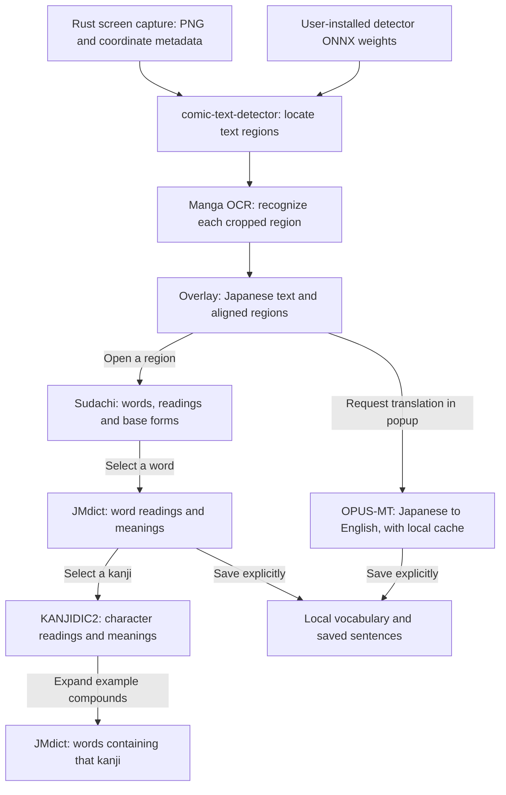

# How YomiMado's resources work together

YomiMado turns a captured image into interactive Japanese text, then loads learning
information as the user explores it. Models recognize images or translate text;
tokenizer dictionaries analyze Japanese; learning dictionaries provide definitions.
These resources serve different stages even when some contain overlapping readings.

This describes the source implementation at `32b5117`, inspected on 2026-10-17.
The size-reduction ideas at the end are proposals, not implemented changes.

## From capture to learning

The arrows show the normal user flow. Kanji lookup does not require a successful
JMdict match: the UI can select kanji from the analyzed word itself. Saving a
sentence also works without translating it first.

1. **Capture:** Rust captures the selected area or scan area using the platform
   capture layer. It supplies a PNG plus physical/image/logical coordinate metadata.
2. **Detect:** the local service uses comic-text-detector code and the separately
   installed detector model to find text regions and orientation. OpenCV, NumPy
   and geometry helpers support image preparation and postprocessing.
3. **Recognize:** Manga OCR recognition reads the cropped regions. The service
   combines the resulting strings with detector geometry. Bounded retries and a
   small-selection fallback can recover text; approximate geometry is marked for
   review. Recognition confidence is currently unknown, represented by `0`.
4. **Overlay:** the frontend maps image polygons into logical overlay coordinates
   using capture metadata, preserving the original manga underneath. The current
   OCR response has empty `tokens` arrays; word analysis happens separately.
5. **Analyze on opening a region:** the popup requests Sudachi analysis of that
   region's text. Tokens identify selectable word spans, readings, base forms and
   parts of speech. Applying an OCR text edit requests fresh analysis.
6. **Look up on selection:** selecting a word queries JMdict. Selecting one of its
   kanji queries KANJIDIC2. Expanding example compounds queries JMdict again.
7. **Translate or save on request:** translation uses the local Japanese-to-English
   model and cache. Saving writes selected learning information to local storage.

## Resource inventory

| Resource                                               | What it contributes                                                                         | Delivery in packaged apps                                                             |
| ------------------------------------------------------ | ------------------------------------------------------------------------------------------- | ------------------------------------------------------------------------------------- |
| Rust/Tauri desktop and React UI                        | Capture, windows, coordinate transforms, overlays and learning controls                     | Bundled                                                                               |
| Frozen Python service                                  | Runs the local APIs and resource adapters without a developer Python installation           | Bundled                                                                               |
| comic-text-detector code                               | Detection and geometry/postprocessing logic                                                 | Bundled                                                                               |
| `comictextdetector.pt.onnx`                            | Learned detector weights: where text is in an image                                         | Installed separately by the user                                                      |
| Manga OCR model, vocabulary and configuration          | Recognition: what the cropped Japanese text says                                            | Bundled; backend differs by platform                                                  |
| UniDic Lite and Fugashi/MeCab support                  | Dictionary and binding used by the configured Japanese OCR tokenizer                        | Bundled in the current tokenizer setup                                                |
| SudachiPy and Sudachi core dictionary                  | Japanese word segmentation, readings, dictionary forms and parts of speech                  | Bundled                                                                               |
| `JMdict_e.gz`                                          | English word meanings, word readings, spelling/reading restrictions and compound candidates | Bundled                                                                               |
| `kanjidic2.xml.gz`                                     | Individual kanji meanings, on'yomi and kun'yomi                                             | Bundled                                                                               |
| OPUS-MT Japanese-to-English model and tokenizer assets | Local sentence translation                                                                  | Bundled; backend differs by platform                                                  |
| OpenCV, NumPy, Pillow and supporting libraries         | Image decoding, preprocessing, arrays and geometry                                          | Bundled                                                                               |
| Licences, notices, checksums and source/build records  | Attribution and provenance for distributed resources                                        | Bundled notices/records; corresponding-source archives are separate release downloads |

The detector's **code and model weights are separate inputs**. The app's
**Select detector model file** action verifies the supported file's SHA-256 and
copies it into the application's writable data directory under
`models/comictextdetector.pt.onnx`. YomiMado does not automatically download it.
The current release policy excludes these detector weights from installers and
public source/artifact delivery. See the [reading guide](usage.md) for setup.

## Why there are two tokenizer dictionaries

The OCR model tokenizer and the learning tokenizer serve different code paths.

**Manga OCR's tokenizer** converts model token IDs into Japanese output text. Its
model configuration selects `BertJapaneseTokenizer` with MeCab and `unidic_lite`.
The current packaging carries that dependency setup. In the Windows ONNX adapter,
the tokenizer is initialized and used to decode generated IDs; the application
does not explicitly ask this OCR tokenizer to split recognized sentences for the
learning UI. Removing UniDic would require verifying a replacement initialization
and decoding path against the existing output.

**Sudachi** analyzes the recognized sentence when its learning popup opens. It
provides the word boundaries and base forms needed to select a word and find an
inflected expression in JMdict. The current implementation uses the core
dictionary and Split Mode C. Its token offsets refer to the original text, so
the UI can preserve punctuation and highlight the selected span.

UniDic is not the dictionary queried by the word popup. Sudachi does not supply
English word definitions, and JMdict does not perform sentence segmentation.

## Where the displayed readings and meanings come from

| UI information                                        | Resource and behavior                                                                                                  |
| ----------------------------------------------------- | ---------------------------------------------------------------------------------------------------------------------- |
| Selected word's reading, base form and token POS      | Sudachi analysis; the UI converts Katakana readings to Hiragana for display                                            |
| Matched dictionary entry's reading and English senses | JMdict; lookup uses the token's surface, dictionary form and reading to rank candidates and respect entry restrictions |
| Reading mismatch hint                                 | Compares the Sudachi reading with the matched JMdict entry reading                                                     |
| Kanji on'yomi, kun'yomi and character meanings        | KANJIDIC2; these are possible character readings, not a per-character split of the word's reading                      |
| Example compounds and their readings/meanings         | JMdict, using its generated kanji-to-word index                                                                        |
| English sentence translation                          | OPUS-MT, requested separately; dictionary senses are not sentence translations                                         |

For example, selecting `学校` first uses Sudachi's word span and reading to make
the lookup request. JMdict supplies matching word definitions and its entry
reading. Selecting `学` then asks KANJIDIC2 for that character's information;
opening example compounds asks JMdict for short words containing `学`.

## macOS and Windows use different inference backends

| Stage                              | macOS Apple Silicon package                                             | Windows x64 package                                                                                                |
| ---------------------------------- | ----------------------------------------------------------------------- | ------------------------------------------------------------------------------------------------------------------ |
| Detector                           | comic-text-detector adapter; user-installed ONNX weights use OpenCV DNN | Adapted detector code with NumPy/OpenCV DNN; same user-installed detector input                                    |
| Recognition                        | Manga OCR through Torch and Transformers, with original PyTorch weights | CPU ONNX Runtime, exported OCR encoder/decoder graphs and matching preprocessing/decoding                          |
| Translation                        | Local Marian/OPUS-MT through Torch and Transformers                     | CPU ONNX Runtime, exported translation encoder/decoder graphs and matching text tokenizer                          |
| Learning analysis and dictionaries | Sudachi, JMdict and KANJIDIC2                                           | Same roles and API contracts                                                                                       |
| Model delivery                     | Original recognition and translation weights                            | Four exported graphs; original export-only PyTorch weights are removed from installer resources after verification |

The Windows build uses Torch in a separate export/reference environment. Torch,
Torchvision and the original Manga OCR Python package are excluded from its
frozen inference runtime. The ONNX adapter retains the recognition model's
preprocessing, vocabulary and decoding behavior. The detector's ONNX file is a
different model from these four bundled recognition/translation graphs.

## Bundled files versus generated user data

The package's `ocr/` resource directory contains `runtime/`, `assets/` and
`notices/`. The desktop launches the frozen service and passes explicit paths to
these inputs. Writable databases and imported detector weights live in Tauri's
application data directory, outside the installed resource tree.

| User data                          | Created or updated when                             | Role                                                                                             |
| ---------------------------------- | --------------------------------------------------- | ------------------------------------------------------------------------------------------------ |
| `models/comictextdetector.pt.onnx` | User imports the supported detector                 | Enables real text detection                                                                      |
| `jmdict-index.sqlite3`             | First word/compound lookup, or source/schema change | Derived word-entry, spelling/reading and kanji-compound indexes; rebuildable from bundled JMdict |
| `translation.sqlite3`              | Translation requests                                | Cached results keyed by provider identity and Japanese source text                               |
| `vocabulary.sqlite3`               | Explicit save/delete actions                        | User-saved words and sentences; not a rebuildable dictionary index                               |

KANJIDIC2 currently parses its gzip XML into an in-memory cache on first lookup;
it does not generate another SQLite database. The word index and translation
cache grow outside the bundle. Saving a dictionary match uses that entry's
reading and senses; saving without a match retains the analyzed token's reading
and an empty meaning list. Saved sentences may include an explicitly requested
translation.

## Local processing and request boundaries

The packaged service binds to `127.0.0.1:8766`; the development default is
`127.0.0.1:8765`. Requests use the local service's client-header/origin/Host guards.
The frontend calls application APIs rather than Python package internals.

| Trigger                          | API                           | Input and result                                                        |
| -------------------------------- | ----------------------------- | ----------------------------------------------------------------------- |
| Capture/scan                     | `POST /api/v1/ocr`            | PNG in; text regions, polygons, orientation and review metadata out     |
| Open region or apply edited text | `POST /api/v1/tokenize`       | Japanese text in; selectable word tokens out                            |
| Select word                      | `POST /api/v1/word`           | Surface, base form and reading in; possible JMdict matches out          |
| Select kanji                     | `POST /api/v1/kanji`          | Character in; KANJIDIC2 details out                                     |
| Expand compounds                 | `POST /api/v1/kanji/examples` | Character and current word to exclude in; JMdict examples out           |
| Request translation              | `POST /api/v1/translate`      | Selected/edited Japanese text in; cached or newly generated English out |

Screenshots remain local and the normal capture flow holds them in memory.
Dictionary, kanji and translation requests carry text, not screenshot images.
The packaged model loaders are configured for offline operation. No cloud
translation provider is selected in the current implementation; the translation
provider boundary allows future implementations. Windows setup may need internet
to install WebView2 if it is missing; that is separate from reading-time inference.

## Size baseline and possible consolidation

The local macOS OCR staging directory measured on 2026-10-17 contains about
**1,661 MiB (1.62 GiB)** of regular-file content, excluding symlink aliases:

| Resource group                                        | Approximate MiB |
| ----------------------------------------------------- | --------------: |
| Frozen runtime, including tokenizer dictionaries      |           920.5 |
| Model assets, learning dictionaries and detector code |           727.6 |
| Notices and records                                   |            12.9 |

Within these groups, Manga OCR assets are 423.7 MiB, translation assets 292.2 MiB,
UniDic Lite 248.4 MiB, Sudachi dictionary 207.1 MiB and Torch 271.2 MiB. The two
compressed learning dictionaries together are only about 11.5 MiB. These figures
describe local staging, not an exact published installer, download compression,
generated user databases or Windows sizes. The desktop binary/UI are additional.

Combining JMdict and KANJIDIC2 into one prepared SQLite database is possible, but
is not implemented. It would simplify loading and could avoid first-run indexing;
an indexed database might occupy more installed space than the compressed XML.
Such a database must preserve word restrictions, readings, attribution and source
provenance. It would not replace Sudachi's morphological analysis dictionary.

The larger candidates for investigation are removing unnecessary UniDic
initialization from OCR decoding, using the Windows ONNX approach on macOS, and
separately evaluating model quantization. Their net size, output quality and
performance effects are unverified. Existing bundles and release evidence remain
the baseline; dependency/model changes require updated source/notices and new
candidate verification under the [shared release checklist](desktop-release.md).

## Implementation references

- Capture and coordinate mapping: [Rust capture](../apps/desktop/src-tauri/src/capture/mod.rs),
  [coordinate transforms](../apps/desktop/src/lib/coordinates.ts).
- Resource paths and lifecycle: [macOS service launch](../apps/desktop/src-tauri/src/lib.rs),
  [Windows service launch](../apps/desktop/src-tauri/src/windows_service.rs),
  [detector import](../apps/desktop/src-tauri/src/detector_model.rs).
- OCR: [shared pipeline](../services/ocr/app/pipeline/real_ocr.py),
  [Windows backend](../services/ocr/windows_onnx_backend.py),
  [ONNX inference](../scripts/onnx_runtime.py),
  [export-only input removal](../scripts/windows_export_inputs.py).
- Learning: [popup triggers](../apps/desktop/src/features/translation/TranslationPopup.tsx),
  [word display](../apps/desktop/src/features/translation/WordDefinition.tsx),
  [Sudachi adapter](../services/ocr/app/tokenizer/sudachi.py),
  [JMdict index/lookup](../services/ocr/app/dictionary/jmdict.py),
  [KANJIDIC2 lookup](../services/ocr/app/dictionary/kanjidic.py).
- Persistence: [translation provider/cache](../services/ocr/app/translation.py),
  [saved words/sentences](../services/ocr/app/vocabulary.py).
- Resource maintenance: [dictionary updates](dictionary-updates.md),
  [asset notices](../THIRD_PARTY_LICENSES/ASSET_NOTICES.md),
  [macOS packaging](macos-release.md), [Windows packaging](windows-release.md).
