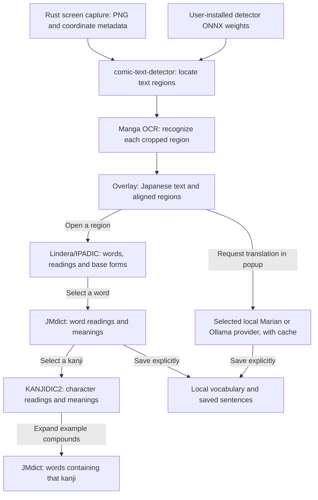

# Architecture and resources

YomiMado is a local-first Japanese manga reading assistant for macOS
and Windows: **Capture → recognize → click → learn**. It preserves the original
manga and adds interactive learning information. The name has not been
trademark/domain/package cleared.

This guide describes the implemented source. Setup belongs in
[development](development.md), user controls in [usage](usage.md), and priorities
in [implementation status and roadmap](implementation-plan.md).

## Product and boundary rules

- Keep OCR and dictionary lookup local. Translate and save only on explicit user
  action; preserve the Japanese alongside translation and cache by provider/text.
- Keep detection/geometry separate from recognition. Preserve polygons,
  orientation, confidence and review metadata through the API. Low confidence
  must remain visible; recognition confidence `0` means unknown.
- Treat vertical Japanese and display scaling as first-class requirements.
  Use the tested transform from screen physical pixels to captured/OCR image
  pixels, overlay logical coordinates and mouse events. Never scatter scale
  calculations or assume these spaces match.
- Keep frontend contracts independent of Python package internals. Token offsets
  refer to source Unicode code points; preserve readings and dictionary forms.
- Use transparent always-on-top OCR regions and anchored popups. Preserve text
  type metadata; sound effects need not use dialogue learning behavior.
- The explicit **Translate bubbles** toggle adds removable white panels at text
  bounds. It does not modify captured pixels or infer speech-bubble interiors.
- Keep providers replaceable behind small interfaces. Current translation is
  local Marian or Ollama; a provider boundary is not permission to add cloud OCR
  or automatically upload screenshots.
- macOS Apple Silicon and Windows 11 x64 are the supported release targets.
  Linux/mobile, continuous OCR, image replacement, accounts/cloud sync and full
  panel reading-order reconstruction remain outside the current scope.

Capture shortcuts use the existing Tauri global-shortcut plugin. Native commands
`capture_shortcuts`, `record_capture_shortcut` and `set_capture_shortcuts` are
limited to the Settings window (`main`). `capture-shortcuts.json` lives in the
app config directory, separate from OCR and saved learning data. Updates register
new chords before atomically replacing the preference file; registration/storage
failures roll back new registrations. The handler dispatches only the active pair,
so an old chord whose unregister failed cannot launch captures. Startup failures
leave the app and toolbar usable and expose shortcut availability in Settings.

Recording uses webview physical key codes and forwards already registered chords
through `capture-shortcut-recorded` on key release. While recording in focused
Settings, those chords do not capture. Focus loss/close ends native recording;
Escape, Tab and category changes also cancel the frontend recorder. Shortcut
registration commands run off the UI thread; the global handler reads atomics
without taking the settings lock while the plugin holds its registry lock.

## Repository map

```text
yomimado/
├── apps/desktop/
│   ├── src/                     React + TypeScript interface
│   │   ├── main.tsx             Selects the view for each native window
│   │   ├── App.tsx              Secondary-window navigation
│   │   ├── features/
│   │   │   ├── toolbar/         Scan controls and More actions menu
│   │   │   ├── capture/         Selection, scan areas, reading order, debug view
│   │   │   ├── overlay/         Interactive OCR region rendering
│   │   │   ├── translation/     Learning popup: words, kanji, selection, translation
│   │   │   ├── library/         Saved words and sentences
│   │   │   └── settings/        OCR setup, translation selection, credits
│   │   ├── lib/                API clients, response validation, coordinates, types
│   │   └── styles/             Shared design tokens and UI primitives
│   ├── src-tauri/
│   │   ├── src/
│   │   │   ├── main.rs         Native executable entry point
│   │   │   ├── lib.rs          Tauri setup, commands, shortcuts, macOS service launch
│   │   │   ├── capture/        xcap capture, page detection, legacy cache cleanup
│   │   │   ├── overlay/        Native overlay/popup placement and input routing
│   │   │   ├── toolbar.rs      Scan sessions, toolbar state, secondary windows
│   │   │   ├── tray.rs         macOS menu bar / Windows notification-area menu
│   │   │   ├── shortcuts.rs    Local capture bindings, registration and recording
│   │   │   ├── detector_model.rs   Checksum-verified detector import
│   │   │   └── windows_service.rs Windows packaged-service lifecycle
│   │   ├── capabilities/      Tauri command permissions
│   │   ├── tauri.conf.json    Development window/build configuration
│   │   ├── tauri.release.conf.json         macOS packaging overrides
│   │   └── tauri.windows-release.conf.json Windows packaging overrides
│   └── package.json           Frontend commands and dependencies
├── services/ocr/
│   ├── app/
│   │   ├── main.py            FastAPI application and request guards
│   │   ├── models.py          API request/response models
│   │   ├── api/               OCR, learning, translation setup, saved-data routes
│   │   ├── pipeline/          OCR selection, detection/recognition, geometry
│   │   ├── tokenizer/         Lindera/IPADIC adapter and comparison-only Sudachi
│   │   ├── dictionary/        JMdict word index and KANJIDIC2 lookup
│   │   ├── translation.py     Translation provider/cache boundary
│   │   ├── translation_preferences.py  Provider selection and local model imports
│   │   ├── translation_resources.py    Optional model component resources
│   │   ├── ollama_translation.py       Local Ollama integration
│   │   ├── vocabulary.py      SQLite saved words/sentences
│   │   └── security.py        Local request guards and upload limits
│   ├── packaged_main.py       Frozen macOS service entry point
│   ├── windows_packaged_main.py       Windows service launcher/support
│   ├── windows_onnx_packaged_main.py  Windows ONNX entry point
│   ├── windows_onnx_backend.py        Windows inference implementation
│   ├── tests/                 Service, API, geometry and persistence tests
│   └── pyproject.toml         Python dependencies, extras and lint/test settings
├── scripts/                   Resource preparation, inference helpers, release tools
│   └── tests/                 Packaging, release and benchmark contract tests
├── .github/workflows/         Checks and protected desktop release workflow
├── docs/                      Setup, usage, design, investigations, release records
├── THIRD_PARTY_LICENSES/       Software/model/data notices and provenance
├── AGENTS.md                  Contributor-agent instructions and scope
├── CHANGELOG.md               Dated changes and verification limits
└── LICENSE                    YomiMado source licence (GPL-3.0-only)
```

Frontend tests live beside their implementation as `*.test.ts` or `*.test.tsx`.
Rust unit tests live inside the native modules. There is currently no
`packages/shared/` package: the frontend contract is in
[`ocr-types.ts`](../apps/desktop/src/lib/ocr-types.ts), the Python contract is in
[`models.py`](../services/ocr/app/models.py), and
[`ocr-response.ts`](../apps/desktop/src/lib/ocr-response.ts) validates OCR responses
at the frontend boundary.

Completed overlays own a temporary bare Escape shortcut in native
`overlay/dismiss.rs`. Visibility/reveal and window-focus transitions synchronize
registration through the existing global-shortcut plugin. The handler reads only
an atomic result generation before dispatching work; it never takes scan or
registration locks under the plugin's handler lock. Native hide requests verify
that the same completed result is visible and no scan is active. Hiding disables
both polygon and control hit routing while retaining the stored result.
`OcrOverlay` reports the hide button's measured CSS rectangle through
`update_overlay_controls`; the existing viewport-to-physical conversion serves
macOS mouse routing and Windows window regions. No new coordinate transform,
input-monitoring grant or dependency is added.

**Translate bubbles** starts off for every new/restored overlay. Its hook makes
sequential, abortable requests through the existing local translation endpoint,
deduplicating identical source text for the run. Re-enabling/Retry consults the
provider-aware service cache again. Toggle-off, unmount and native input-router
disable stop queued work and ignore late replies; server-side inference already
running may complete. A failure stops the queue and leaves unprocessed Japanese
visible. Demo boundaries and known sound effects are excluded; unknown region
types remain eligible without changing their OCR metadata.

`BubbleTranslation` renders fitted text in SVG foreign objects using
`ocrPolygonToOverlay`. Panels first use available width and height at 18 CSS px, then reduce
the font down to 11 px. Growth is bounded to 240 × 220 CSS px unless the original
region is larger, and uses only the space the measured text needs. Each pair of
regions shares a horizontal or vertical gap at its midpoint, including diagonal
neighbors, with a 4 px separation when space permits. Overlapping source regions
are not enlarged. The captured area bounds the panels. This is not inferred bubble segmentation. Measured panel rectangles and the translation strip use the
existing native control route, bounded to one panel per region plus two control
areas. This also extends Windows' visible window region to the rectangular
panels. Original polygons continue to own keyboard navigation; translated panels
mirror their review/selection borders and accept pointer input and scrolling.
Text that cannot fit at 11 px stays visible from its first line with vertical
scrolling instead of an ellipsis. Opening a translated region passes
an explicit `translateOnOpen` popup option; the popup requests its full translation
through the same provider/cache, with normal errors and stale-source guards.

The tray's **Show OCR results** action calls the existing overlay visibility path
on a worker thread. Tray refresh reads scan/result availability under the scan
lock; restore checks active scans again and validates the retained display before
navigating the overlay. Showing an already-visible result is a no-op, preserving
its webview and focus. The action does not invoke capture or OCR.

## How a scan moves through the code

1. The floating toolbar or global shortcut starts a native scan session in
   `toolbar.rs` and `lib.rs`. `main.tsx` selects the capture view for the selector
   window. Selected Area asks for a drag; Whole Screen tries page detection and
   uses a saved/drawn area when necessary.
2. Rust `capture/` captures a PNG in memory and supplies the display/crop metadata.
   `CaptureSelector.tsx` coordinates the capture and calls `lib/ocr-client.ts`,
   which uploads the image to the local service.
3. Python `api/ocr.py` validates the request and runs `pipeline/`. The detector
   supplies regions and orientation; Manga OCR supplies text. An unconfigured
   development service returns a labeled demo boundary instead of OCR text.
4. The frontend validates the response, uses `lib/coordinates.ts` to map image
   polygons into overlay logical coordinates, and asks the Rust overlay module
   to show the result. `OcrOverlay.tsx` renders the interactive regions.
5. Clicking a region opens `TranslationPopup.tsx`. Its API clients request word
   analysis, dictionary entries and kanji details from the Python service.
   Translation and saving run only after explicit user actions.

Preserve polygons, orientation and review metadata across these boundaries.
Capture pixels, OCR image coordinates and overlay logical coordinates differ on
Retina/scaled displays. Token offsets use Unicode code points, not JavaScript
UTF-16 indices. Recognition confidence `0` means unknown, and approximate regions
carry review metadata. See [resources and data flow](#resources-and-data-flow) for the
model, dictionary and storage details.

## Local service usage

Development runs the service separately at `http://127.0.0.1:8765`; `tauri dev`
does not start it. Packaged apps start their bundled service on port `8766`.
Frontend requests go through `src/lib/service-client.ts`; release builds configure
the packaged URL. `VITE_OCR_URL` overrides the frontend URL at Vite startup/build
time. Keep the service bound to loopback.

| Route                                           | Purpose                                                                  |
| ----------------------------------------------- | ------------------------------------------------------------------------ |
| `GET /health`                                   | Service availability and selected OCR engine; does not prove models load |
| `POST /api/v1/ocr`                              | Multipart PNG field `image`; optional form field `debug`                 |
| `POST /api/v1/tokenize`                         | Japanese text to word tokens with source offsets                         |
| `POST /api/v1/word`                             | Local JMdict lookup for a surface/base form/reading                      |
| `POST /api/v1/kanji`                            | Local KANJIDIC2 meanings and readings                                    |
| `POST /api/v1/kanji/examples`                   | Local JMdict example compounds                                           |
| `POST /api/v1/translate`                        | Explicit text translation using the selected local provider/cache        |
| `GET/POST /api/v1/translation-settings`         | Inspect or select the translation provider                               |
| `POST /api/v1/translation-settings/import`      | Import a compatible local Marian model folder                            |
| `GET /api/v1/translation-settings/ollama`       | Inspect local Ollama availability/models                                 |
| `POST /api/v1/translation-settings/ollama/pull` | Explicitly request an Ollama model download                              |
| `GET/POST /api/v1/vocabulary`                   | List or save words                                                       |
| `DELETE /api/v1/vocabulary/{word_id}`           | Remove a saved word                                                      |
| `GET/POST /api/v1/sentences`                    | List or save sentences                                                   |
| `DELETE /api/v1/sentences/{sentence_id}`        | Remove a saved sentence                                                  |

All `/api/` calls require `X-YomiMado-Client: desktop`. For example, after starting
the development service, run these from a terminal; replace the PNG path with
your own local or synthetic fixture:

```sh
curl --fail-with-body http://127.0.0.1:8765/health
curl --fail-with-body http://127.0.0.1:8765/api/v1/ocr -H 'X-YomiMado-Client: desktop' -F 'image=@/absolute/path/capture.png;type=image/png'
```

On Windows PowerShell, use `curl.exe` for these examples. For full JSON schemas,
open `http://127.0.0.1:8765/docs` while the service is running. Use a client such as
curl to supply the required header for API calls. API routes and Pydantic models
are the source of truth for request fields. The header is a browser request
guard, not a secret.

### Request guards and limits

The service rejects non-loopback Host headers and untrusted browser origins.
`X-YomiMado-Client: desktop` forces browser preflight; it is a request guard, not
secret authentication against native local processes. Requests are bounded before
JSON/multipart parsing: 32 MiB for an OCR upload including multipart overhead,
1 MiB for other requests, and PNG dimensions of at most 40 million pixels and
16,384 pixels per side. Byte limits still apply to poorly compressing images.

## Where to make changes

| Task                                     | Start here                                                                    |
| ---------------------------------------- | ----------------------------------------------------------------------------- |
| Change toolbar controls or scan feedback | `src/features/toolbar/`, native `toolbar.rs`                                  |
| Change capture or page cropping          | Native `capture/`, `src/features/capture/`                                    |
| Fix alignment or hit testing             | `src/lib/coordinates.ts`, native `overlay/`, `src/features/overlay/`          |
| Change OCR detection or recognition      | `services/ocr/app/pipeline/`; Windows backend for packaged Windows            |
| Change token boundaries or readings      | `services/ocr/app/tokenizer/`                                                 |
| Change dictionary lookup                 | `services/ocr/app/dictionary/` and `app/api/word.py` / `kanji.py`             |
| Change the learning popup                | `src/features/translation/`                                                   |
| Change saved collections                 | `src/features/library/`, service `vocabulary.py` and `api/vocabulary.py`      |
| Change translation setup/provider        | `src/features/settings/`, service `translation*.py` / `ollama_translation.py` |
| Change installer/source delivery         | `scripts/`, `.github/workflows/release.yml`, platform release configs         |

Here `src/` and native paths refer to `apps/desktop/src/` and
`apps/desktop/src-tauri/src/`, respectively. Use
[development checks](development.md#local-checks) for the affected layer.
Packaging and source-delivery scripts have their own
[script guide](../scripts/README.md) and [release checklist](desktop-release.md).

## Generated and user-local files

`node_modules/`, `dist/`, Rust `target/`, Python `.venv/`, `*.egg-info/` and
generated Tauri schemas are build/development outputs. The git-ignored
`services/ocr/local-models/`, `local-dictionaries/`, `local-fixtures/`,
`services/ocr/build/` and `apps/desktop/src-tauri/resources/ocr/` hold local assets
and staging data. Do not commit manga screenshots, model downloads or local
databases. In contrast, tracked manifests, locks and licence records under
`docs/` and `THIRD_PARTY_LICENSES/` are required source/build inputs.

Saved learning data and translation caches are outside the source tree by
default; standalone development and packaged apps use different storage paths.
See [development setup](development.md) for paths and environment overrides,
[dictionary updates](dictionary-updates.md) for resource maintenance, and
[implementation status](implementation-plan.md) for source-versus-installer
verification. New installer publication still requires owner authorization.

## Resources and data flow

### From capture to learning



The arrows show the normal user flow. Kanji lookup does not require a successful
JMdict match: the UI can select kanji from the analyzed word itself. Saving a
sentence also works without translating it first.

The [scan path](#how-a-scan-moves-through-the-code) describes the implementation.
Recognition confidence is unknown (`0`); approximate recovery geometry is marked
for review. OCR replies currently have empty `tokens` arrays: learning analysis
runs when the region popup opens. Automatic retry/crop behavior is recorded in
[the optimization report](detector-retry-optimization.md).

Before recognition, ambiguous horizontal detector blocks on a plain light/dark
background can be localized using connected glyph components. Whitespace separates
rows/columns, neighboring detector blocks bound end recovery, and rotated/vertical,
low-contrast or artwork-like cases retain their detector path. Refinement accepts
at most 16 rows per block and 32 row crops per scan. Recognized rows supersede
covered fragments; other unresolved overlaps retain their text and a review flag.
Refined crops use the existing `expandedCrop` source with an explicit reason and
unknown confidence. Original detector boxes remain in debug output, output ordering
follows the original detector sequence, and polygons are clipped to image bounds
before publication. The stroke fallback uses an enclosing oriented rectangle.
No detector passes, model weights or display-coordinate transforms are added.

For mixed-content selections, touching fragments of a horizontal row can be
reconciled before applying neighboring-column guards. A nearby vertical fragment
can extend the search only when complete, wide glyph rows support that interpretation;
weak evidence retains the original barriers. Searches include a bounded margin
above/below detector edges and decline partially observed rows. Recognition still
precedes suppression: successful rows must cover at least 95% of a competing
fragment's visible ink on a plain background. Multiple rows can jointly cover a
false vertical run; a padded single-row duplicate also needs matching height and
center. This coverage applies to full, tile and mask results, preserving fragments
with uncovered glyphs. Localized rows do not enter the legacy box-overlap retry
filter; failed row recognition leaves fallback crops available. Existing row/crop
limits and original debug boxes remain.

Detector regions classified `eng` stay separate from Japanese/unknown horizontal
fragments and carry an explicit non-Japanese review reason, even if the Japanese
recognizer returns Japanese-looking text. Selection and short vertical recovery
append their geometry reasons without replacing earlier warnings, including in
expanded-crop diagnostics. This is a warning from the detector's
coarse classification, not Thai OCR or reliable script identification; unknown
regions can still contain recognition errors. See the
[mixed-content measurements](ocr-mixed-text-results.json) and
[geometry acceptance cases](ui-testing.md#horizontal-ocr-geometry-recovery).

## Resource inventory

| Resource                                               | What it contributes                                                                         | Delivery in packaged apps                                                             |
| ------------------------------------------------------ | ------------------------------------------------------------------------------------------- | ------------------------------------------------------------------------------------- |
| Rust/Tauri desktop and React UI                        | Capture, windows, coordinate transforms, overlays and learning controls                     | Bundled                                                                               |
| Frozen Python service                                  | Runs the local APIs and resource adapters without a developer Python installation           | Bundled                                                                               |
| comic-text-detector code                               | Detection and geometry/postprocessing logic                                                 | Bundled                                                                               |
| `comictextdetector.pt.onnx`                            | Learned detector weights: where text is in an image                                         | Installed separately by the user                                                      |
| Manga OCR model, vocabulary and configuration          | Recognition: what the cropped Japanese text says                                            | Bundled; backend differs by platform                                                  |
| OCR vocabulary and decode-only Japanese tokenizer      | Decode generated model IDs into the original Japanese text                                  | Bundled; UniDic/Fugashi/MeCab excluded from frozen runtime                            |
| Lindera 6.0.0 and its pinned IPADIC dictionary         | Japanese word segmentation, readings, dictionary forms and parts of speech                  | Binding in frozen runtime; dictionary in `assets/lindera-ipadic`                      |
| `JMdict_e.gz`                                          | English word meanings, word readings, spelling/reading restrictions and compound candidates | Bundled                                                                               |
| `kanjidic2.xml.gz`                                     | Individual kanji meanings, on'yomi and kun'yomi                                             | Bundled                                                                               |
| OPUS-MT Japanese-to-English model and tokenizer assets | Local sentence translation                                                                  | User-imported Marian; macOS Torch / Windows ONNX; Ollama managed separately           |
| OpenCV, NumPy, Pillow and supporting libraries         | Image decoding, preprocessing, arrays and geometry                                          | Bundled                                                                               |
| Licences, notices, checksums and source/build records  | Attribution and provenance for distributed resources                                        | Bundled notices/records; corresponding-source archives are separate release downloads |

The detector's **code and model weights are separate inputs**. The app's
**Select detector model file** action verifies the supported file's SHA-256 and
copies it into the application's writable data directory under
`models/comictextdetector.pt.onnx`. YomiMado does not automatically download it.
The current release policy excludes these detector weights from installers and
public source/artifact delivery. See the [installation guide](installation-guide.md) for setup.

## OCR decoding and learning tokenization

The OCR model tokenizer and the learning tokenizer serve different code paths.

**Manga OCR's tokenizer** converts model token IDs into Japanese output text.
The original model configuration selects MeCab and `unidic_lite`, but the app now
constructs this OCR-only tokenizer with word tokenization disabled. Its original
vocabulary, special tokens and decoding stay intact. Frozen runtimes exclude the
large UniDic dictionary and Fugashi/MeCab bindings. The same helper serves the
macOS recognizer and Windows ONNX path. Translation's text tokenizer is separate.

**Lindera/IPADIC** analyzes the recognized sentence when its learning popup opens. It
provides the word boundaries and base forms needed to select a word and find an
inflected expression in JMdict. The implementation uses the pinned v6.0.0 IPADIC
resource in normal mode. UTF-8 byte offsets are converted to Unicode code-point
offsets referring to the original text, so
the UI can preserve punctuation and highlight the selected span.

The OCR vocabulary is not the dictionary queried by the word popup. IPADIC does not supply
English word definitions, and JMdict does not perform sentence segmentation.

## Where the displayed readings and meanings come from

| UI information                                        | Resource and behavior                                                                                                  |
| ----------------------------------------------------- | ---------------------------------------------------------------------------------------------------------------------- |
| Selected word's reading, base form and token POS      | Lindera/IPADIC analysis; the UI converts Katakana readings to Hiragana for display                                     |
| Matched dictionary entry's reading and English senses | JMdict; lookup uses the token's surface, dictionary form and reading to rank candidates and respect entry restrictions |
| Reading mismatch hint                                 | Compares the IPADIC reading with the matched JMdict entry reading                                                      |
| Kanji on'yomi, kun'yomi and character meanings        | KANJIDIC2; these are possible character readings, not a per-character split of the word's reading                      |
| Example compounds and their readings/meanings         | JMdict, using its generated kanji-to-word index                                                                        |
| English sentence translation                          | Selected local Marian or Ollama provider; dictionary senses are not sentence translations                              |

For example, selecting `学校` first uses Lindera's word span and reading to make
the lookup request. JMdict supplies matching word definitions and its entry
reading. Selecting `学` then asks KANJIDIC2 for that character's information;
opening example compounds asks JMdict for short words containing `学`.

## macOS and Windows use different inference backends

| Stage                              | macOS Apple Silicon package                                                 | Windows x64 package                                                                                              |
| ---------------------------------- | --------------------------------------------------------------------------- | ---------------------------------------------------------------------------------------------------------------- |
| Detector                           | comic-text-detector adapter; user-installed ONNX weights use OpenCV DNN     | Adapted detector code with NumPy/OpenCV DNN; same user-installed detector input                                  |
| Recognition                        | Manga OCR through Torch and Transformers, with original PyTorch weights     | CPU ONNX Runtime, exported OCR encoder/decoder graphs and matching preprocessing/decoding                        |
| Translation                        | Imported Marian through Torch/Transformers, or local Ollama                 | Imported Marian ONNX graphs and matching text tokenizer, or local Ollama                                         |
| Learning analysis and dictionaries | Lindera/IPADIC, JMdict and KANJIDIC2                                        | Same roles and API contracts                                                                                     |
| Model delivery                     | Recognition weights bundled; translation imported or managed through Ollama | OCR graphs bundled; Marian translation graphs imported separately; original export-only PyTorch weights excluded |

The Windows build uses Torch in a separate export/reference environment. Torch,
Torchvision and the original Manga OCR Python package are excluded from its
frozen inference runtime. The ONNX adapter retains the recognition model's
preprocessing, vocabulary and decoding behavior. The detector's ONNX file is separate from the recognition graphs and optional
translation graphs.

## Bundled files versus generated user data

The package's `ocr/` resource directory contains `runtime/`, `assets/` and
`notices/`. The desktop launches the frozen service and passes explicit paths to
these inputs. Writable databases and imported detector weights live in Tauri's
application data directory, outside the installed resource tree.

| User data                          | Created or updated when                             | Role                                                                                             |
| ---------------------------------- | --------------------------------------------------- | ------------------------------------------------------------------------------------------------ |
| `models/comictextdetector.pt.onnx` | User imports the supported detector                 | Enables real text detection                                                                      |
| `jmdict-index.sqlite3`             | First word/compound lookup, or source/schema change | Derived word-entry, spelling/reading and kanji-compound indexes; rebuildable from bundled JMdict |
| `translation.sqlite3`              | Translation requests                                | Cached results keyed by provider identity and Japanese source text                               |
| `vocabulary.sqlite3`               | Explicit save/delete actions                        | User-saved words and sentences; not a rebuildable dictionary index                               |

KANJIDIC2 currently parses its gzip XML into an in-memory cache on first lookup;
it does not generate another SQLite database. The word index and translation
cache grow outside the bundle. Saving a dictionary match uses that entry's
reading and senses; saving without a match retains the analyzed token's reading
and an empty meaning list. Saved sentences may include an explicitly requested
translation.

Packaged user data lives under `~/Library/Application Support/com.yomimado.desktop`
on macOS or `%APPDATA%\com.yomimado.desktop` on Windows. Packaged notices are at
`Contents/Resources/ocr/notices/` on macOS and `<install directory>\ocr\notices` on
Windows. Standalone service defaults and environment overrides are in
[development setup](development.md).

## Saved-data backup contract

`GET /api/v1/backup` exports a version-1 `yomimado-saved` JSON document containing
`createdAt`, `words`, `sentences` and JMdict attribution. Records retain saved
fields and timestamps, excluding database IDs. Both collections are read in one
SQLite snapshot. `POST /api/v1/backup/preview` validates the entire document and
counts new/duplicate records without importing. `POST /api/v1/backup/restore`
revalidates and inserts missing records in a single `BEGIN IMMEDIATE` transaction.
Existing records are never overwritten. Word identity is `(surface, reading,
source_text)`; sentence identity is `source_text`, matching the existing unique
constraints. Duplicates inside a file keep the first entry. Counts are recalculated
under the write reservation, including saves since preview.

The portable models in [`backup.py`](../services/ocr/app/backup.py) enforce field,
date, version and collection limits. Save dates are normalized to UTC while
preserving their instant. Unsupported versions, unknown fields, duplicate JSON
keys, malformed Unicode and invalid records reject the whole file. A 16 MiB body
allowance applies only to the two backup POST routes; other JSON/OCR request
limits and loopback origin/client-header guards remain. Exports exceeding 16 MiB
or 50,000 records per collection fail rather than silently truncating.

Native `choose_learning_backup` and `save_learning_backup` commands are restricted
to the `saved` window, use the existing dialog plugin and accept no webview-provided
file paths. Reads are bounded and validate the JSON envelope. Writes sync a unique
staging file beside the selected destination and rename it only when complete;
failures clean up staging and preserve an existing backup. POSIX staging permissions
are owner-only. Backup files carry saved learning data, never screenshots, models,
preferences or translation caches. No database schema, resource or dependency changes
are required. See [user controls](usage.md#local-backup-and-restore).

## Translation selection and cache

`YOMIMADO_TRANSLATION_RESOURCES` points to the model resource root; packaged apps
use `models/translation` in app data. `preferences.json` records the explicit
provider selection. Imported files live under `custom/<content-hash>/model`, with
sibling ONNX files where applicable. Every request snapshots its provider;
imported content hashes or Ollama model names/digests keep cache entries separate.
An unconfigured selection returns setup guidance instead of using an environment
path or default-model fallback. Historical component archives/APIs remain part of
release verification, while the settings UI offers local import and Ollama.

## Resource decisions and measurements

The current source uses Lindera/IPADIC, decode-only OCR and user-installed local
translation. Retained size and inference comparisons are in the
[Lindera migration](lindera-migration.md), [resource-reduction report](optional-translation-and-ocr-size.md),
[macOS ONNX investigation](macos-onnx-investigation.md) and
[decoder cache/CoreML follow-up](macos-onnx-cache-coreml.md).

## Implementation references

- Capture and coordinate mapping: [Rust capture](../apps/desktop/src-tauri/src/capture/mod.rs),
  [coordinate transforms](../apps/desktop/src/lib/coordinates.ts).
- Resource paths and lifecycle: [macOS service launch](../apps/desktop/src-tauri/src/lib.rs),
  [Windows service launch](../apps/desktop/src-tauri/src/windows_service.rs),
  [detector import](../apps/desktop/src-tauri/src/detector_model.rs).
- OCR: [shared pipeline](../services/ocr/app/pipeline/real_ocr.py),
  [Windows backend](../services/ocr/windows_onnx_backend.py),
  [ONNX inference](../scripts/onnx_runtime.py),
  [export-only input removal](../scripts/windows_export_inputs.py).
- Learning: [popup triggers](../apps/desktop/src/features/translation/TranslationPopup.tsx),
  [word display](../apps/desktop/src/features/translation/WordDefinition.tsx),
  [Lindera adapter](../services/ocr/app/tokenizer/lindera.py),
  [JMdict index/lookup](../services/ocr/app/dictionary/jmdict.py),
  [KANJIDIC2 lookup](../services/ocr/app/dictionary/kanjidic.py).
- Persistence: [translation provider/cache](../services/ocr/app/translation.py),
  [saved words/sentences](../services/ocr/app/vocabulary.py).
- Resource maintenance: [dictionary updates](dictionary-updates.md),
  [asset notices](../THIRD_PARTY_LICENSES/ASSET_NOTICES.md),
  [macOS packaging](macos-release.md), [Windows packaging](windows-release.md).
